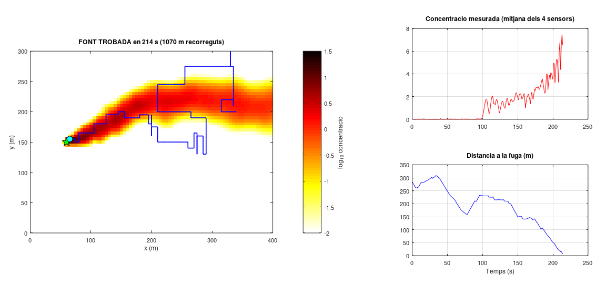

# Versió preliminar: dron que busca una fuga seguint el gradient

Un sol fitxer MATLAB, `simulacio_dron_gradient.m`, que simula en 2D una ploma turbulenta de contaminant i un dron que en busca l'origen seguint el gradient de concentració. No té infotaxis ni ploma gaussiana: és la versió mínima per mostrar el progrés del projecte.

## Com executar-lo

1. Obre `simulacio_dron_gradient.m` a MATLAB (R2016b o posterior; no cal cap toolbox).
2. Prem **F5** (o escriu `simulacio_dron_gradient` a la finestra de comandes).
3. Tots els paràmetres són al bloc `PARAMETRES`, al principi del fitxer. Per veure una prova diferent canvia `llavor` (o posa `llavor = [];` perquè cada execució sigui diferent).

També funciona amb GNU Octave.

## Com funciona

El programa repeteix un bucle amb pas de temps `dt = 1 s`. A cada pas passa això:

### 1. La ploma evoluciona (model de *puffs*)

La fuga no s'escriu com una fórmula fixa, sinó com un núvol de *puffs*: petits núvols de gas que la font emet contínuament (2 per segon) i que el vent s'emporta. Cada puff té una posició $(x_i, y_i)$, una mida $\sigma_i$ i una massa $m_i$, i té forma de campana de Gauss. La concentració en un punt és la suma de tots els puffs:

$$c(x,y) = \sum_i \frac{m_i}{2\pi\sigma_i^2}\exp\left(-\frac{(x-x_i)^2+(y-y_i)^2}{2\sigma_i^2}\right)$$

A cada pas (funció `avancar_ploma`):

- **Vent amb meandreig.** La direcció del vent $\theta$ oscil·la a l'atzar amb un procés d'Ornstein-Uhlenbeck: un soroll aleatori amb memòria, que canvia de manera suau i sempre tendeix a tornar a la direcció mitjana. $\theta \leftarrow a\,\theta + \sigma_\theta\sqrt{1-a^2}\,\xi$, amb $a = e^{-\Delta t/T}$ i $\xi$ un nombre aleatori normal. $\sigma_\theta = 15°$ és l'amplitud típica de l'oscil·lació i $T = 40$ s el temps que tarda a "oblidar" la direcció anterior. Això fa que la ploma sigui sinuosa.
- **Advecció i turbulència.** Advecció vol dir ser arrossegat pel vent. Cada puff es mou amb el vent, $(U\cos\theta, U\sin\theta)\,\Delta t$, més un desplaçament aleatori de desviació $\sqrt{2D_{turb}\Delta t}$ que representa els remolins petits (difusió turbulenta). Aquest desplaçament fa que la ploma sigui irregular, amb grumolls.
- **Eixamplament.** Cada puff creix per difusió: $\sigma^2 \leftarrow \sigma^2 + 2D_{puff}\Delta t$ (llei de la difusió d'Einstein/Fick).
- **Esvaïment.** La massa decau com $m \leftarrow m\,e^{-\Delta t/\tau}$ ($\tau$ = temps de vida del contaminant).
- **Emissió i neteja.** La font emet els puffs nous, amb massa total $Q\,\Delta t$, i s'esborren els que surten de la zona.

Abans que surti el dron, la ploma evoluciona 300 s perquè ja estigui formada.

### 2. El dron mesura amb 4 sensors en creu

El dron porta 4 sensors a una distància $d = 5$ m del centre: est, oest, nord i sud. Cada sensor llegeix la concentració real més un soroll gaussià (desviació 0,05). Les lectures negatives es posen a zero.

### 3. Estima el gradient i el suavitza

El gradient és el vector que apunta cap on la concentració augmenta més de pressa. S'estima amb **diferències finites centrades**: la diferència entre sensors oposats dividida per la distància entre ells.

$$g_x = \frac{c_E - c_O}{2d},\qquad g_y = \frac{c_N - c_S}{2d}$$

Si algun sensor supera el llindar de detecció (0,1), el gradient nou es barreja amb l'anterior mitjançant un **filtre de mitjana mòbil exponencial** (EMA):

$$\vec g_f \leftarrow \alpha\,\vec g_f + (1-\alpha)\,\vec g$$

Amb $\alpha = 0{,}95$ el dron fa, en la pràctica, la mitjana de les últimes $1/(1-\alpha) = 20$ mesures. Aquest filtre és imprescindible: en una ploma turbulenta el gradient instantani és molt sorollós. Resultats en 10-20 proves:

| $\alpha$ | 0,6 | 0,8 | 0,9 | 0,95 | 0,97 |
|---|---|---|---|---|---|
| Èxit | 0 % | 10 % | 90 % | 100 % | 90 % |

### 4. Decideix: seguir el gradient o explorar

- **Seguir el gradient.** Si ha detectat gas en els últims 8 passos (`memoria`), el dron es mou en la direcció (est, nord, oest o sud) on la projecció del gradient filtrat és més gran, és a dir, `max(dirs * gf')`. Moure's només en 4 direccions és important. Fora de l'eix de la ploma, el gradient apunta cap al centre de la ploma, però també una mica *vent avall*, perquè la ploma s'eixampla. Si el dron seguís el gradient exacte, aniria allunyant-se de la font. Triant només la component dominant, quan és fora de l'eix es mou cap al centre de la ploma, i quan hi és, el gradient lateral és gairebé zero i domina la component cap a la font. Una primera versió que seguia la direcció exacta del gradient no va trobar la fuga cap vegada.
- **Explorar.** Si no detecta res, fa un **passeig aleatori correlacionat**: manté la direcció i, a cada pas, amb probabilitat 0,15 gira 90° a esquerra o dreta. Així recorre la zona en trams rectes en lloc de fer voltes sobre el mateix lloc.

### 5. Es mou i comprova si ha arribat

El dron avança 5 m (velocitat 5 m/s durant 1 s). Si sortiria de la zona, fa mitja volta. Es considera que ha trobat la fuga quan és a menys de 7,5 m d'ella. El temps màxim de vol és de 2500 s.

### 6. Dibuix

A l'esquerra hi ha el mapa de la ploma (escala logarítmica), la fuga (estrella verda), el dron (cercle blau) i la trajectòria. A la dreta, la concentració mesurada i la distància a la fuga en funció del temps. El títol diu si el dron està *seguint el gradient* o *explorant*.

## Resultats

Amb els paràmetres per defecte i 20 llavors diferents, el dron troba la fuga en les 20 proves:

- temps mitjà: 497 s;
- mediana: 319 s;
- mínim: 121 s; màxim: 1249 s.

Les proves lentes són aquelles en què el dron passa de llarg la font. Al costat de la font que mira cap al vent no hi arriba gas, així que el dron perd la ploma i l'ha de retrobar a l'atzar. Aquesta és una limitació coneguda dels mètodes de gradient en plomes turbulentes, i el motiu pel qual la literatura proposa estratègies com l'infotaxis (següent pas del projecte).

## Fonts

**Idees i models:**

- **Model de puffs.** J. A. Farrell, J. Murlis, X. Long, W. Li i R. T. Cardé (2002), "Filament-based atmospheric dispersion model to achieve short time-scale structure of odor plumes", *Environmental Fluid Mechanics* 2, 143-169. La ploma com a suma de puffs gaussians que el vent transporta i que creixen i es dispersen; el nostre model n'és una versió simplificada.
- **Procés d'Ornstein-Uhlenbeck.** G. E. Uhlenbeck i L. S. Ornstein (1930), "On the theory of the Brownian motion", *Physical Review* 36, 823-841. Per al meandreig del vent.
- **Difusió ($\sigma^2 = \sigma_0^2 + 2Dt$).** A. Einstein (1905), *Annalen der Physik* 17, 549-560. Resultat clàssic de la difusió.
- **Robots que segueixen el gradient amb diversos sensors.** H. Ishida, Y. Kagawa, T. Nakamoto i T. Moriizumi (1996), "Odor-source localization in the clean room by an autonomous mobile sensing system", *Sensors and Actuators B* 33, 115-121; i R. A. Russell, A. Bab-Hadiashar, R. L. Shepherd i G. G. Wallace (2003), "A comparison of reactive robot chemotaxis algorithms", *Robotics and Autonomous Systems* 45, 83-97.
- **Visió general dels mètodes.** G. Kowadlo i R. A. Russell (2008), "Robot odor localization: a taxonomy and survey", *The International Journal of Robotics Research* 27, 869-894.
- **Passeig aleatori correlacionat.** E. A. Codling, M. J. Plank i S. Benhamou (2008), "Random walk models in biology", *Journal of the Royal Society Interface* 5, 813-834.
- **Filtre exponencial.** S. W. Smith (1997), *The Scientist and Engineer's Guide to Digital Signal Processing*, cap. 19 (filtres recursius d'un pol).
- **Per què el gradient falla en plomes turbulentes.** M. Vergassola, E. Villermaux i B. I. Shraiman (2007), "'Infotaxis' as a strategy for searching without gradients", *Nature* 445, 406-409; i J. Murlis, J. S. Elkinton i R. T. Cardé (1992), "Odor plumes and how insects use them", *Annual Review of Entomology* 37, 505-532.

**Codi:** el codi s'ha escrit des de zero per a aquest projecte. És una versió simplificada de la simulació completa de la branca `main` d'aquest repositori. No s'ha copiat de cap altre repositori. Els valors dels paràmetres són plausibles però no mesurats; $\alpha$ s'ha ajustat amb proves.
