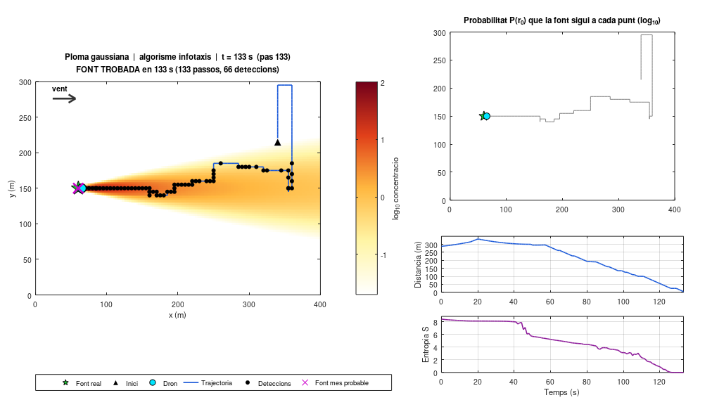
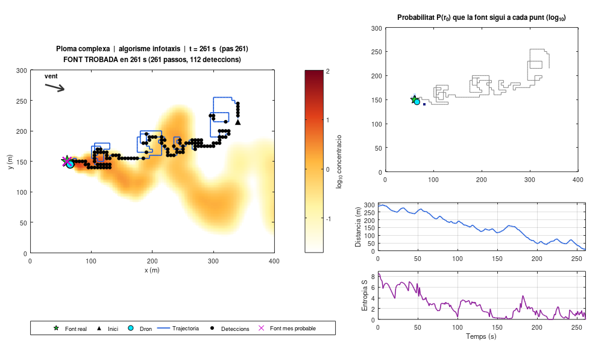
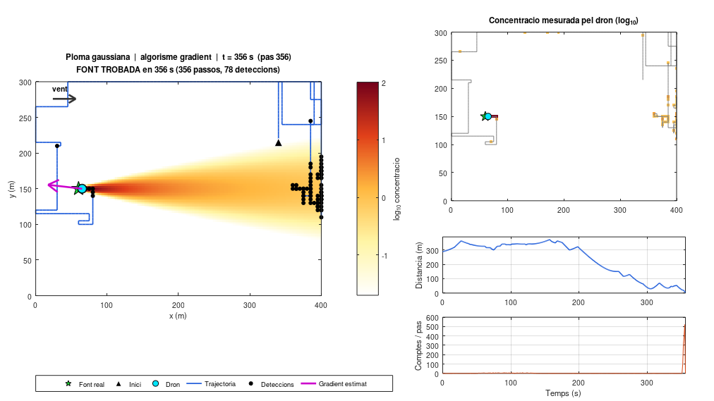
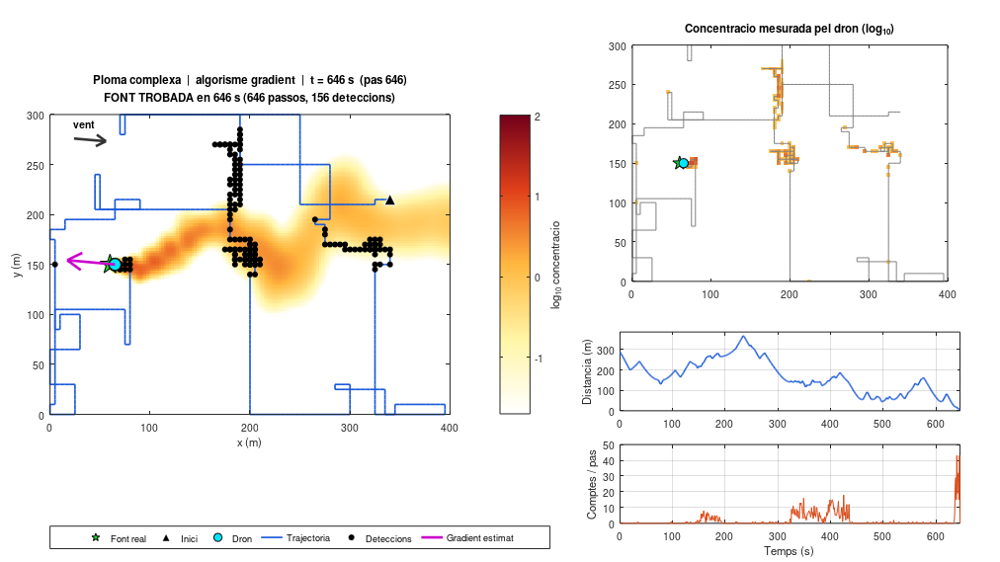
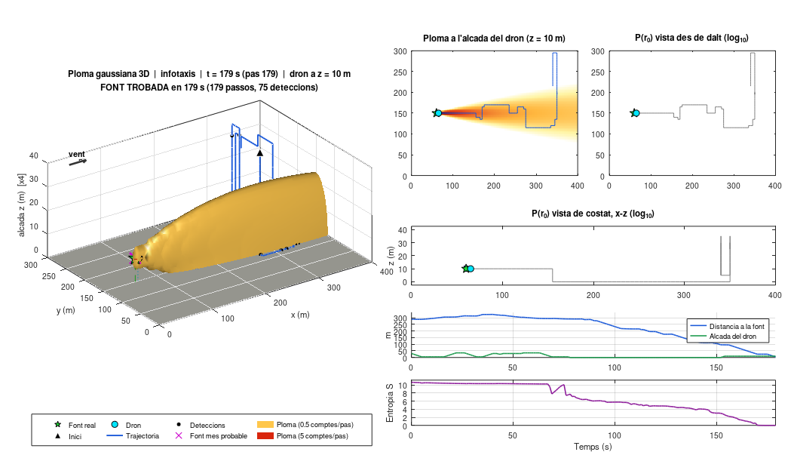
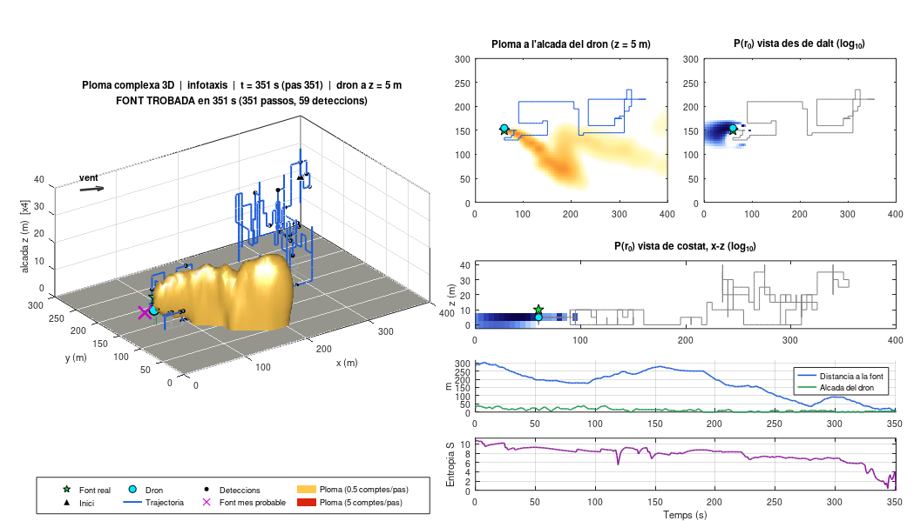

# Dron autònom per trobar l'origen d'una fuga

Simulació en MATLAB d'un dron que busca l'origen d'una fuga de contaminant (química o radioactiva) a partir només de les lectures del seu sensor. Es pot triar el **model de ploma** (gaussiana o complexa) i l'**algorisme de cerca** (infotaxis, de l'article de Vergassola *et al.* 2007, o gradient), i es veu en directe com el dron fa la cerca.

Projecte: *Disseny i programació d'un dron aeri autònom per a la mesura de contaminació i determinació del seu origen* (Ignasi Reichardt, 2026-2027).

Es pot simular en **2D**, amb el dron volant a una alçada fixa, o en **3D**, on la fuga pot ser a qualsevol alçada i el dron també es mou amunt i avall. Es tria amb una sola opció del mateix script, igual que la ploma o l'algorisme. Vegeu [Versió 3D](#versió-3d).

| Ploma gaussiana + infotaxis | Ploma complexa + infotaxis |
|---|---|
|  |  |
| **Ploma gaussiana + gradient** | **Ploma complexa + gradient** |
|  |  |

## Com s'executa

1. Obre MATLAB (R2016b o posterior; no cal cap toolbox) a la carpeta `matlab/`.
2. Obre `main_simulacio.m` i tria les opcions al principi:
   ```matlab
   dimensio   = '2d';          % '2d'  o  '3d'
   tipusPloma = 'gaussiana';   % 'gaussiana'  o  'complexa'
   algorisme  = 'infotaxis';   % 'infotaxis'  o  'gradient'
   escenariAleatori = true;    % false = sempre el mateix escenari
   modeRealista = false;       % true = limitacions tècniques del dron (vegeu "Mode realista")
   ```
3. Executa'l (F5). S'obre una finestra amb l'animació i, en acabar, surt un resum a la consola.

Si poses `preguntarOpcions = true`, el programa et demana la dimensió, la ploma, l'algorisme, el tipus d'escenari i si vols el dron ideal o realista per la finestra de comandes. La resta de paràmetres es poden canviar a l'apartat **ALTRES PARÀMETRES** del mateix script (hi ha exemples comentats) o als fitxers de configuració.

### Escenaris aleatoris

Amb `escenariAleatori = true` (l'opció per defecte a `main_simulacio.m`), cada execució sorteja unes condicions inicials noves: la posició de la fuga, la posició inicial del dron i la direcció i la velocitat del vent. El dron sempre surt a una distància mínima de la fuga (150 m) i **a sotavent**, és a dir, vent avall, dins d'un con de ±60° al voltant de la direcció del vent. És el cas realista: la contaminació s'ha detectat vent avall i el dron hi va a buscar-ne l'origen.

- Amb `escenariAleatori = false` sempre es fa servir el mateix escenari, el de `configuracio_defecte.m` (o `configuracio_defecte_3d.m` en 3D).
- Es pot triar què es sorteja i en quins marges amb els camps `cfg.atzar.*` de `configuracio_defecte.m`: `font`, `dron`, `ventDireccio`, `ventVelocitat`, `estabilitat` (classe A–F), `emissio` (taxa Q), i els seus rangs.
- Hi ha dues llavors (*seeds*: el número que inicia el generador de nombres aleatoris). `llavorEscenari` controla l'escenari i `llavor` la turbulència i el soroll del sensor. Si són `[]`, canvien cada cop. En acabar, la consola escriu les llavors utilitzades: si les copies a `main_simulacio.m`, pots repetir exactament aquella prova.

### Gravar un vídeo

Posa `gravarVideo = true` a `main_simulacio.m`. El vídeo es desa a la carpeta **`matlab/videos/`**, que es crea automàticament, amb un nom que inclou la ploma, l'algorisme, la data i l'hora (per exemple `cerca_2d_gaussiana_infotaxis_20261013_153000.mp4`). La consola indica on s'ha desat. El darrer fotograma es manté 2 s perquè es pugui llegir el resultat.

- `formatVideo` pot ser `'mp4'` (per defecte), `'avi'` o `'gif'` (GIF animat, útil per a presentacions; es redueix a la meitat de resolució perquè no ocupi tant).
- Si l'ordinador no pot gravar MP4 (MATLAB a Linux), es desa en AVI. GNU Octave no té `VideoWriter` i desa un GIF.
- Si tanques la finestra o atures la simulació amb Ctrl+C, el vídeo gravat fins aquell moment es tanca bé i es pot reproduir.

Els fitxers `.asv` que poden aparèixer al costat dels scripts no tenen res a veure amb el vídeo: són les còpies de seguretat automàtiques que fa l'editor de MATLAB quan modifiques un fitxer. Es poden esborrar sense problema.

### Comparativa Monte Carlo

Per comparar els algorismes estadísticament (mètode de **Monte Carlo**: repetir la simulació moltes vegades amb nombres aleatoris diferents i fer estadística dels resultats), executa `comparativa_montecarlo.m` (amb l'opció `dimensio = '2d'` o `'3d'`). Fa 20 cerques per combinació sense animació i en mostra la taxa d'èxit i el temps de cerca. Amb `escenarisAleatoris = true`, cada repetició té un escenari diferent, però el mateix per a tots els algorismes, perquè la comparació sigui justa.

També funciona amb GNU Octave (provat amb la versió 8.4). Com que Octave dibuixa més lentament, val la pena posar `cfg.visual.cadaNPassos = 5`.

## Què es veu a l'animació

- **Panell gran (esquerra):** la ploma real en escala logarítmica de colors, la font (estrella verda), el punt d'inici (triangle), el dron (cercle blau), la seva trajectòria i els punts on ha detectat contaminant (punts negres). La fletxa indica el vent (a la ploma complexa canvia de direcció). Amb infotaxis, la creu lila és on el dron creu que és més probable que hi hagi la font; amb gradient, la fletxa lila és el gradient que ha estimat.
- **Panell superior dret:** el que "sap" el dron. Amb infotaxis és la probabilitat P(r₀) que la font sigui a cada punt; es veu com es concentra a mesura que el dron rep informació. Amb gradient és el mapa de les concentracions que ha mesurat.
- **Panells inferiors drets:** la distància a la font i l'entropia (infotaxis) o el nombre de comptes del sensor (gradient).

## Estructura

```
matlab/
├── main_simulacio.m           ← script principal (tria 2D/3D, ploma i algorisme)
├── comparativa_montecarlo.m   ← estadística de moltes cerques (2D o 3D)
├── funcions/                  ← versió 2D i funcions comunes (vídeo, escenaris, Poisson...)
│   ├── configuracio_defecte.m ← TOTS els paràmetres 2D (amb comentaris)
│   ├── simular_cerca.m        ← bucle de simulació
│   ├── ploma_*.m, sigma_briggs.m   ← models de ploma
│   ├── sensor_llegir.m, poisson_aleatori.m   ← model del sensor
│   ├── infotaxis_*.m, model_taxa_deteccio.m, versemblanca.m, entropia.m
│   ├── gradient_*.m
│   ├── video_*.m, aplicar_escenari_aleatori.m
│   └── visualitzacio_*.m, mapa_colors.m
└── funcions3d/                ← versió 3D (totes acaben en _3d)
    ├── configuracio_defecte_3d.m ← TOTS els paràmetres 3D
    └── simular_cerca_3d.m, ploma_*_3d.m, infotaxis_*_3d.m, ...
```

## Models de ploma

### 1. Ploma gaussiana (`'gaussiana'`)

És el model clàssic de dispersió atmosfèrica: una font puntual que emet de manera contínua, amb un vent constant, dona un núvol estacionari (que no canvia amb el temps) amb forma de con. La concentració a l'alçada de vol del dron *z* és:

$$c(s,n)=\frac{Q}{2\pi u\,\sigma_y\sigma_z}\,e^{-\frac{n^2}{2\sigma_y^2}}\left[e^{-\frac{(z-H)^2}{2\sigma_z^2}}+e^{-\frac{(z+H)^2}{2\sigma_z^2}}\right]$$

on *s* és la distància a sotavent (en la direcció del vent), *n* la distància transversal, *Q* la taxa d'emissió, *u* la velocitat del vent i *H* l'alçada de la font. El segon terme del claudàtor representa la "reflexió" del contaminant al terra. Les amplades σ_y(s) i σ_z(s) creixen amb la distància segons la **classe d'estabilitat de Pasquill-Gifford** (de A, atmosfera molt turbulenta que dispersa molt, fins a F, atmosfera molt estable), amb les fórmules de Briggs (`sigma_briggs.m`). Per evitar que la concentració sigui infinita just a la font, aquesta té una mida inicial σ₀ = 1 m.

Aquest model representa el **camp mitjà**. L'única aleatorietat és el soroll de recompte del sensor, i per això és el cas "fàcil".

### 2. Ploma complexa (`'complexa'`)

És un **model lagrangià de *puffs*** (Farrell *et al.*, 2002). "Lagrangià" vol dir que se segueix el moviment de porcions de contaminant en comptes de calcular un camp sobre una graella. La font emet contínuament petits núvols gaussians (*puffs*) que:

- són **transportats pel vent**, que no és constant: la direcció *meandreja* (oscil·la) i la intensitat té *ràfegues*. Totes dues es modelen amb processos d'**Ornstein-Uhlenbeck**, un soroll aleatori "amb memòria" que varia de manera suau, amb un temps de correlació característic;
- són desviats per **remolins de gran escala**: un camp de velocitat sense divergència (que no crea ni destrueix aire), obtingut d'una funció de corrent ψ, que viatja amb el vent mitjà;
- es **dispersen per turbulència**: el centre fa un camí aleatori (difusió turbulenta) i el *puff* s'eixampla (difusió relativa);
- **decauen** amb un temps de vida τ, per desintegració radioactiva, deposició o reacció química.

El resultat és una ploma sinuosa i filamentosa. Lluny de la font, el contaminant arriba a pegats separats per zones buides: és el **límit diluït** de l'article, on les deteccions són esporàdiques i no hi ha un gradient útil.

## Model del sensor

El dron porta un sensor de **recompte** (com un comptador Geiger o un detector de partícules): durant cada pas de temps Δt compta un nombre aleatori de deteccions *k* que segueix una **llei de Poisson** (la llei dels esdeveniments aleatoris independents):

$$k\sim\text{Poisson}(\mu),\qquad \mu=\Delta t\,(\kappa\,c+b)$$

on κ és la sensibilitat del sensor i *b* el **soroll de fons** (deteccions falses o radioactivitat natural). Quan la concentració és baixa, el sensor sovint marca 0 encara que hi hagi contaminant: aquest soroll de recompte és el que fa difícil la cerca.

## Algorismes de cerca

El dron es mou per una graella de cel·les de mida dx (5 m per defecte). A cada pas pot anar a una de les 4 cel·les veïnes o quedar-se quiet, i triga Δt = dx / velocitat. La fuga es considera trobada quan el dron hi és a menys d'un **radi de detecció** (1,5·dx), a una distància on la podria veure amb una càmera.

### Infotaxis (`'infotaxis'`), de l'article

Idea: en comptes de seguir la concentració, el dron segueix la **informació**.

1. **Probabilitat posterior P(r₀).** El dron manté un mapa amb la probabilitat que la font sigui a cada punt r₀. Al principi és uniforme (no en sap res). La posterior és la probabilitat *actualitzada* amb les mesures. Cada cop que mesura *k* comptes, l'actualitza amb la **regla de Bayes** (eq. 2 de l'article):

   $$P_{t+1}(r_0)\propto P_t(r_0)\cdot\text{Poisson}\big(k;\,\mu(r\,|\,r_0)\big)$$

   És a dir, augmenta la probabilitat de les posicions de la font que expliquen bé el que ha mesurat. A més, la zona on és el dron passa a tenir probabilitat 0, perquè si la font hi fos ja l'hauria trobada.

2. **Entropia de Shannon** $S=-\sum P\ln P$. Mesura la incertesa: és màxima quan P és uniforme i val 0 quan se sap exactament on és la font. Segons l'article, el temps esperat de cerca creix com $e^{S}$, així que reduir l'entropia és acostar-se a trobar la font.

3. **Decisió (eq. 1 de l'article).** Per a cada moviment possible (4 veïns o quedar-se quiet), el dron calcula quant espera que baixi l'entropia:

   $$\overline{\Delta S}(r\to r_j)=P(r_j)\,[-S]+\big[1-P(r_j)\big]\sum_k\rho_k(r_j)\,\Delta S_k$$

   - El primer terme és l'**explotació**: la probabilitat de trobar la font just allà (l'entropia passaria a ser 0).
   - El segon terme és l'**exploració**: si no la troba, rebrà *k* comptes amb probabilitat ρ_k, i cada resultat canviaria l'entropia en ΔS_k.

   Tria el moviment amb el $\overline{\Delta S}$ més negatiu, és a dir, el que maximitza el guany d'informació esperat. Aquest equilibri entre explotar i explorar és el que produeix les trajectòries en ziga-zaga (*casting*) semblants a les de les arnes.

4. **Model intern** $\mu(r|r_0)$. El dron necessita saber quants comptes esperaria rebre a *r* si la font fos a *r₀* (`model_taxa_deteccio.m`):
   - Ploma gaussiana: fa servir la mateixa fórmula gaussiana (model perfecte).
   - Ploma complexa: fa servir la solució mitjana de l'**equació d'advecció-difusió** de l'article (material suplementari, eq. 5). "Advecció" és el transport pel vent i "difusió", l'escampament per turbulència:
     $$c(r|r_0)=\frac{Q}{2\pi D}\,e^{\frac{sV}{2D}}\,K_0\!\left(\frac{|r-r_0|}{\lambda}\right),\qquad \lambda=\sqrt{\frac{D\tau}{1+V^2\tau/4D}}$$
     on $K_0$ és la funció de Bessel modificada. Aquest model **no** coneix el meandreig, les ràfegues ni els remolins; només en té una difusivitat efectiva *D*. Serveix per comprovar la robustesa de l'algorisme davant d'errors de model, tal com fa l'article.

Detalls d'implementació:
- Per calcular el sumatori de l'eq. 1 sense un cost excessiu quan hi ha molts comptes, els recomptes s'agrupen en intervals (0, 1, 2, 3-4, 5-7, …) (`cfg.infotaxis.binsComptes`). L'actualització bayesiana sí que fa servir el valor exacte de *k*.
- Amb `cfg.infotaxis.saturacio = 1` el sensor és binari (detecta / no detecta), com en molts treballs posteriors a l'article.
- Si la posterior ja està tan concentrada que cap moviment aporta informació (entropia ≈ 0 lluny de la font), el dron vola directament cap al punt més probable. Sense aquest pas, quedaria aturat.

### Gradient (`'gradient'`), quimiotaxi clàssica

El dron porta 5 sensors: un al centre i 4 en creu (a +x, −x, +y, −y), com si n'hi hagués un a cada braç d'un quadricòpter. Estima el gradient (la direcció on la concentració augmenta més) per diferències finites:

$$\frac{\partial c}{\partial x}\approx\frac{c_E-c_O}{2d},\qquad\frac{\partial c}{\partial y}\approx\frac{c_N-c_S}{2d}$$

i el suavitza amb una mitjana mòbil exponencial per reduir el soroll. Es mou cap al veí en la direcció del gradient (mode *seguiment*). Si fa uns quants passos que no detecta res, fa un **passeig aleatori correlacionat** (manté la direcció amb una certa probabilitat i, si no, gira) fins que torna a trobar senyal (mode *exploració*).

Com explica el material suplementari de l'article (secció 1), mesurar un gradient amb soroll de recompte requereix molt de senyal, i el temps necessari creix exponencialment amb la distància a la font. Per això el gradient funciona bé a prop de la font d'una ploma suau, però falla en el límit diluït o amb plomes turbulentes.

## Resultats típics

Amb els paràmetres per defecte (domini de 400 × 300 m, dron a ~290 m de la fuga, 5 m/s), sobre 5 realitzacions:

| Ploma | Algorisme | Èxit | Temps de cerca |
|---|---|---|---|
| gaussiana | infotaxis | 5/5 | 120 – 260 s |
| gaussiana | gradient | 5/5 | 160 – 870 s |
| complexa | infotaxis | 5/5 | 220 – 350 s |
| complexa | gradient | 4/5 | 650 – 1900 s (o no la troba) |

L'infotaxis és més ràpid i més fiable, sobretot amb la ploma complexa, on el gradient sovint es perd. Per a estadístiques més sòlides, executa `comparativa_montecarlo.m`.

## Paràmetres principals (`configuracio_defecte.m`)

| Paràmetre | Defecte | Significat |
|---|---|---|
| `domini.Lx, Ly, dx` | 400, 300, 5 m | mida del domini i de la cel·la |
| `font.pos` | [60 150] m | posició real de la fuga (el dron no la coneix) |
| `dron.posInicial` | [340 215] m | punt de sortida |
| `dron.velocitat` | 5 m/s | defineix Δt = dx/v |
| `dron.maxPassos` | 2500 | límit d'autonomia |
| `vent.direccio` | 0° | cap on bufa el vent |
| `atzar.activat` | false (true a `main_simulacio.m`) | escenari aleatori |
| `atzar.font`, `atzar.dron`, `atzar.ventDireccio`, `atzar.ventVelocitat` | true | què es sorteja |
| `atzar.estabilitat`, `atzar.emissio` | false | també es poden sortejar |
| `atzar.distanciaMinima` | 150 m | distància mínima dron–fuga |
| `atzar.dronASotavent`, `atzar.angleMaxim` | true, 60° | el dron surt vent avall |
| `sensor.sensibilitat` | 1 | comptes/s per unitat de concentració (baixa-la per fer el senyal més diluït) |
| `sensor.fons` | 0.02 /s | deteccions falses |
| `gauss.estabilitat` | 'D' | classe A..F |
| `complexa.sigmaTheta` | 15° | amplitud del meandreig del vent |
| `complexa.nRemolins` | 6 | remolins de gran escala (0 = cap) |
| `infotaxis.saturacio` | Inf | 1 = sensor binari |
| `infotaxis.factorModel` | 1 | per simular un error de calibratge del model intern |
| `gradient.alfa` | 0.6 | filtre del gradient (0 = cap) |
| `visual.gravarVideo` | false | desa un vídeo a `videos/` |
| `visual.formatVideo` | 'mp4' | 'mp4', 'avi' o 'gif' |
| `visual.fpsVideo` | 15 | fotogrames per segon del vídeo |

## Versió 3D

| Ploma gaussiana 3D + infotaxis | Ploma complexa 3D + infotaxis |
|---|---|
|  |  |

**Com s'executa:** al mateix `matlab/main_simulacio.m`, posa `dimensio = '3d'` i prem F5. Els escenaris aleatoris i el vídeo funcionen igual que en 2D (vegeu [Escenaris aleatoris](#escenaris-aleatoris) i [Gravar un vídeo](#gravar-un-vídeo)). En 3D també se sortegen l'alçada de la fuga (0–20 m) i l'alçada inicial del dron (10–40 m). Els paràmetres 3D són a `matlab/funcions3d/configuracio_defecte_3d.m`.

**Què canvia respecte de la 2D:**

- **Domini:** volum de 400 × 300 × 40 m amb cel·les de 5 m. La fuga és per defecte a 10 m d'alçada (`cfg.font.pos = [60 150 10]`) i el dron surt a 30 m. El dron pot fer 7 accions: quedar-se quiet, ±x, ±y, pujar o baixar. La fuga es dona per trobada quan el dron hi és a menys de 7,5 m en horitzontal i **a la mateixa alçada** (`cfg.dron.toleranciaAlcada = 0`; es pot permetre una diferència d'alçada posant-hi, per exemple, 5 m).
- **Ploma gaussiana 3D:** la mateixa fórmula de Pasquill-Gifford, però ara el dron la mesura a l'alçada on vola. El terme de reflexió fa que el contaminant que toca el terra hi "reboti".
- **Ploma complexa 3D:** els *puffs* són núvols gaussians 3D que:
  - es dispersen més en horitzontal que en vertical (l'atmosfera barreja menys en vertical);
  - reboten al terra;
  - són transportats per un vent que augmenta amb l'alçada segons el **perfil potencial** $U(z)=U\,(z/z_{ref})^{p}$, la forma típica del vent a la capa límit atmosfèrica (la capa d'aire en contacte amb el terra, on el fregament frena el vent).
- **Infotaxis 3D:** la probabilitat P(r₀) es defineix sobre tot el volum, de manera que el dron també dedueix a quina alçada és la fuga. El model intern per a la ploma complexa és la fórmula 3D de l'article (material suplementari, eq. 6) amb dues ampliacions:
  - una difusivitat horitzontal $D_h$ i una de vertical $D_v$ diferents;
  - una **font imatge** sota terra, el mètode clàssic per imposar que el terra no deixi passar el contaminant.

  $$c(r|r_0)=\frac{Q}{4\pi\sqrt{D_hD_v}}\,e^{\frac{sV}{2D_h}}\left[\frac{e^{-r_1/\lambda}}{r_1}+\frac{e^{-r_2/\lambda}}{r_2}\right]$$

  on $r_1$ i $r_2$ són les distàncies a la font i a la seva imatge, amb l'eix vertical escalat per $\sqrt{D_h/D_v}$. Com que el terra trenca la simetria vertical, el model es guarda en una taula 4D: desplaçament horitzontal, alçada del dron i alçada de la font.
- **Gradient 3D:** el dron porta 7 sensors (centre, ±x, ±y, un a sobre i un a sota) i també estima el gradient vertical. En exploració es mou sobretot en horitzontal i canvia d'alçada de tant en tant (`cfg.gradient.probVertical`).

**Què es veu a l'animació 3D:**

- **Esquerra:** l'escena 3D. La ploma es dibuixa com a superfícies d'igual concentració (taronja = vora, vermell = interior). També hi ha la trajectòria del dron i la seva ombra al terra, les deteccions i la font. L'eix vertical està exagerat ×4 per poder veure les alçades. Es pot girar amb el ratolí.
- **Dalt a la dreta:** el tall horitzontal de la ploma a l'alçada on vola el dron, i el que sap el dron vist des de dalt.
- **Al mig a la dreta:** el que sap el dron vist de costat (x-z). Aquí es veu com dedueix l'alçada de la fuga.
- **A baix a la dreta:** la distància a la font, l'alçada del dron i l'entropia o els comptes.

**Resultats típics (3D, escenari fix, 3 realitzacions; en tots els èxits el dron acaba a l'alçada exacta de la fuga):**

| Ploma | Algorisme | Èxit | Temps de cerca |
|---|---|---|---|
| gaussiana | infotaxis | 3/3 | 170 – 210 s |
| gaussiana | gradient | 3/3 | 500 – 880 s |
| complexa | infotaxis | 3/3 | 205 – 355 s |
| complexa | gradient | 2/3 | 1530 – 2300 s (o no la troba) |

Amb 12 escenaris aleatoris per ploma, l'infotaxis 3D troba la fuga, a la seva alçada, en tots 24.

L'infotaxis 3D és més costós de calcular que el 2D (unes 44.000 cel·les en lloc de 5.000). Si l'animació va lenta, puja `cadaNPassos` (per exemple a 3). Per a l'estadística en 3D, posa `dimensio = '3d'` a `comparativa_montecarlo.m`.

## Mode realista (limitacions tècniques del dron)

Per defecte la simulació és **ideal**: el dron es mou 5 m per segon, mesura a l'instant i no té límit de bateria. Amb `modeRealista = true` (a `main_simulacio.m` o a `comparativa_montecarlo.m`) s'hi apliquen les limitacions tècniques del dron de la **fitxa tècnica del Dron Simon**. Cadascuna té el seu interruptor (`activat = true/false`) i els seus valors, que es poden regular al bloc «MODE REALISTA» de `main_simulacio.m`. L'explicació detallada de cada paràmetre és a `funcions/configuracio_realista.m`.

| Limitació | Paràmetres (valor per defecte) | D'on surt | Què fa a la simulació |
|---|---|---|---|
| Velocitat de cerca | `R.velocitat.valor` (2 m/s) | La fitxa recomana volar a poc a poc pel temps de resposta del PID | Cada pas de 5 m dura més |
| Temps de mesura | `R.tempsMesura.valor` (8 s) | El dron s'atura en vol estacionari per mesurar | El dron s'espera a cada punt i acumula la mesura: més senyal i menys soroll, però més temps i més bateria |
| Resposta del sensor | `R.respostaSensor.T90` (8 s) | MiniPID 2: T90 < 8 s | La lectura segueix la concentració real amb retard |
| Hèlices (*downwash*) | `R.helices.dilucio` (0,10), `R.helices.soroll` (0,20) | Tub de presa de 80 cm fora del corrent de les hèlices | Barreja aire net amb la mostra i hi afegeix fluctuacions |
| Gas | `R.gas.nom` (`'benze'`), `R.gas.tempsDilucio` (2 s), `R.gas.midaFont` (0,5 m) | Objectiu del projecte: benzè | La ploma puja o baixa segons la densitat del gas |
| Bateria | `R.bateria.energia` (389 Wh), `R.bateria.potencia` (390 W), `R.bateria.fraccioUtil` (0,8), `R.bateria.extraMoviment` (0,10), `R.bateria.retornBase` (true) | Bateria Li-ion 6S4P i càlcul d'autonomia de la fitxa | La missió s'acaba quan l'energia que queda només arriba per tornar a la base |
| Saturació | `R.saturacio.valor` (100 ppm) | Rang del MiniPID 2 | Les lectures no poden passar de 100 ppm |
| Error del GPS | `R.errorGPS.valor` (1,5 m) | GPS Holybro M10 | La mesura es pren en un punt una mica diferent del que creu el dron |
| Error de l'anemòmetre | `R.errorVent.valor` (3°) | Anemòmetre ultrasònic a bord | El model intern del dron fa servir una direcció de vent lleugerament equivocada |

En mode realista la concentració s'interpreta en **ppm** (parts per milió).

**Com es modela cada limitació:**

- **Temps de cada pas.** Un pas dura $\Delta t = d_x/v + t_{\text{mesura}}$. Amb els valors per defecte, $5/2 + 8 = 10{,}5$ s. Mentre el dron es desplaça i mentre espera, la ploma continua evolucionant (amb un pas intern d'1 s). Els comptes del sensor s'acumulen durant l'espera; si no hi ha espera, durant el viatge.
- **Resposta del sensor.** Es modela com un **filtre de primer ordre**: la lectura s'acosta a la concentració real exponencialment, amb una constant de temps $\tau = T_{90}/\ln 10$ (amb $T_{90} = 8$ s, $\tau \approx 3{,}5$ s). $T_{90}$ és el temps que triga a arribar al 90 % d'un canvi brusc. Si el dron no s'espera prou, la mesura encara reflecteix l'aire d'on venia.
- **Hèlices.** La mostra es dilueix amb una fracció d'aire net, de manera que $c \to c\,(1-d)$, i es multiplica per un soroll lognormal de mitjana 1 i coeficient de variació (desviació relativa) `soroll`. Gràcies al tub de 80 cm que surt fora del corrent, l'efecte és petit; sense tub caldria posar una dilució de l'ordre de 0,5. Per comparar, la velocitat de l'aire que empenyen les hèlices en vol estacionari és $v_i = \sqrt{mg/(2\rho A)} \approx 5$ m/s.
- **Densitat del gas** (model simplificat de flotabilitat). La **gravetat reduïda** $g' = g\,(\rho_{\text{aire}}-\rho_{\text{gas}})/\rho_{\text{aire}}$ mesura quant pesa més o menys el gas que l'aire. Dona una velocitat vertical inicial $w_0 = \pm\sqrt{|g'|\,L}$, on $L$ és la mida de la fuga, que decau a mesura que el gas es barreja amb l'aire: $w(t)=w_0\,e^{-t/\tau_g}$. Per tant, la ploma es desplaça en vertical $\Delta h(t) = w_0\,\tau_g\,(1-e^{-t/\tau_g})$: amunt els gasos lleugers, avall els pesants, i mai per sota del terra.

  | Gas | Densitat (kg/m³) | Comportament |
  |---|---|---|
  | `'heli'` (He) | 0,17 | puja molt |
  | `'meta'` (CH₄, gas natural) | 0,67 | puja |
  | `'benze'` (C₆H₆, vapor) | 3,25 | baixa |
  | `'propa'` (C₃H₈, GLP) | 1,83 | baixa |
  | `'co2'` | 1,83 | baixa |

  En 2D, el dron vola a l'alçada de la fuga: si el gas puja o baixa, a l'alçada de vol n'arriba menys. En 3D la ploma es desplaça de debò, i el dron ha de buscar-la més amunt o més avall. Amb un gas pesant, per exemple, val la pena volar més baix.
- **Bateria.** L'autonomia en vol estacionari és $t = f\,E/P = 0{,}8 \cdot 389\ \text{Wh} / 390\ \text{W} \approx 48$ min, el mateix càlcul que la fitxa. Quan el dron es desplaça consumeix un 10 % més. Si `retornBase` està activat, la missió s'acaba quan l'energia que queda, menys la d'un pas més, ja no arriba per tornar al punt d'enlairament. Llavors la consola i el títol diuen **BATERIA BAIXA**. El títol de l'animació mostra la bateria que queda.
- **Errors del GPS i de l'anemòmetre.** A cada pas, la mesura es pren en una posició desplaçada aleatòriament (desviació típica de 1,5 m). L'error de direcció del vent se sorteja un cop per missió i desvia el model intern del dron. La consola mostra quant val.

**Què sap el dron.** El model intern de l'infotaxis coneix les limitacions que es poden calibrar: el temps de mesura, la dilució mitjana de les hèlices, la saturació i el gas que busca. No coneix ni les fluctuacions, ni el retard del sensor, ni l'error del GPS, ni el del vent: són errors de model, com en un dron real.

**Resultats típics** (2D, escenari fix, totes les limitacions amb els valors per defecte, 4 llavors):

| Ploma | Infotaxis | Gradient |
|---|---|---|
| Gaussiana | 2/4 trobades (20 – 32 min), 2/4 sense bateria | 0/4 (sense bateria) |
| Complexa | 3/4 trobades (22 – 40 min), 1/4 sense bateria | 0/4 (sense bateria) |

Amb l'autonomia del dron (~48 min) i mesures de 8 s, una cerca des de ~300 m va justa de bateria. És el tipus d'estudi que proposa el pla de treball de novembre: si el dron és adequat (velocitat, autonomia) per seguir la ploma. Prova, per exemple, d'escurçar el temps de mesura, de volar més de pressa o de canviar de gas.

**Limitació del model:** l'algorisme de gradient suposa 4 sensors (6 en 3D) separats 5 m, però el dron real només en porta un (el PID). Per al Dron Simon, l'infotaxis, que funciona amb un sol sensor, és l'algorisme realista.

## Idees per continuar el projecte

- Estudiar com depèn el temps de cerca de la distància inicial, de la sensibilitat del sensor o de la velocitat del dron (pla de treball de novembre i desembre).
- Comprovar la robustesa de l'infotaxis davant d'errors en el model intern (`factorModel`, `Dmodel`, direcció del vent mal estimada).
- Aprendre els paràmetres del medi a partir de les deteccions (secció 5 del material suplementari).
- Tenir en compte les correlacions temporals entre deteccions (secció 6, eq. 12-13), que són importants a la ploma complexa.
- Afegir l'elevació de plomes calentes (*plume rise*), obstacles (edificis) o un sostre per inversió tèrmica a la versió 3D.
- Permetre moviments en diagonal (8 direccions en 2D, 26 en 3D).

## Referències

- M. Vergassola, E. Villermaux, B. I. Shraiman, "'Infotaxis' as a strategy for searching without gradients", *Nature* **445**, 406–409 (2007), i el seu material suplementari.
- J. A. Farrell, J. Murlis, X. Long, W. Li, R. T. Cardé, "Filament-based atmospheric dispersion model to achieve short time-scale structure of odor plumes", *Environmental Fluid Mechanics* **2**, 143–169 (2002).
- G. A. Briggs, "Diffusion estimation for small emissions", ATDL Report 79 (1973).
- H. C. Berg, E. M. Purcell, "Physics of chemoreception", *Biophysical Journal* **20**, 193–219 (1977).
